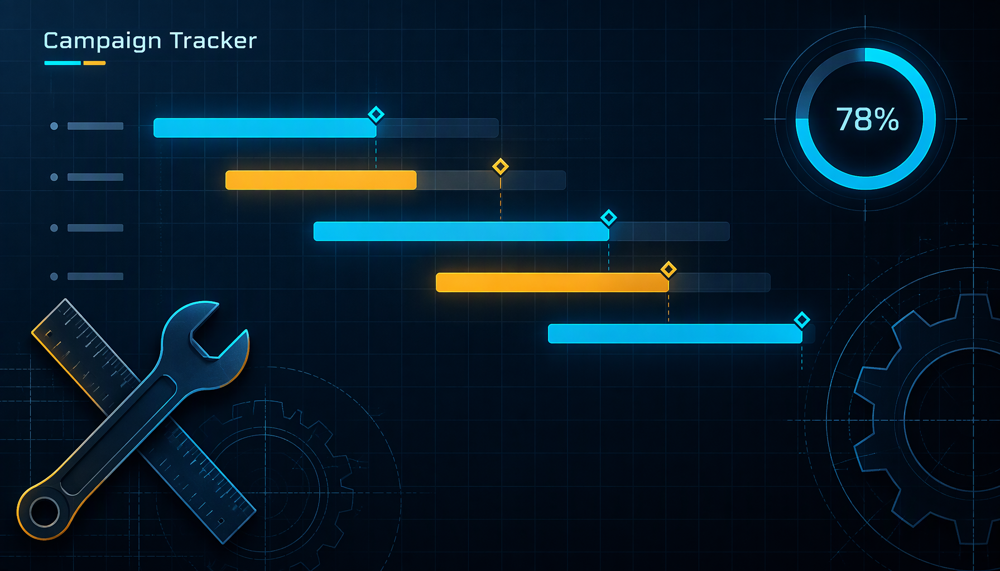

# Campaign Success Tracker

A single-file, zero-backend dashboard that answers the one question field-and-dealer campaigns always
dodge — **did the programme actually pay for itself, or would parking the money have been better?** It
measures a campaign with the industry-standard **incremental-lift (counterfactual)** method: baseline = the
same sales month last year, lift = actual − baseline, attribution auto-derived from a control market
(difference-in-differences), valued at gross contribution, netted against phased investment, then converted
into ROI / ROMI / payback / IRR / NPV against a bank-deposit hurdle. Two fictional NexaGroup units
(Nexa Cement, Nexa Steel) can be viewed together or apart. Modern dark-first design system (Fira type, blue
+ amber tokens) with a light-mode toggle, and Chart.js **inlined** so it runs fully offline.



[](https://vercel.com/new)
[](#run--deploy)
[](#demo-data-disclaimer)

## Tabs

Dashboard · Methodology · Assumptions · Data · Control Market · Analysis · Results · Sources — each mirrors a
sheet of the original spreadsheet model, so the workbook logic and the web view agree line by line. Filter by
unit (Both / Nexa Cement / Nexa Steel).

## Run / deploy

```bash
open index.html          # double-click works too — self-contained, no build, no backend
```

Static single file; only aggregated results are published. Vercel: **Import** → Framework preset **Other** ·
Root `.` · build command *empty*.

## Features

- **Verdict banner per unit** (SUCCESS / PARTIAL / UNDERPERFORMING) versus the risk-free bank hurdle.
- **Monthly tracker** — baseline, target, actual, lift, lift %, attributed contribution, net, monthly ROI,
  with a TOTAL row recomputed live from the stored monthly cells.
- **Control-market tab** that *derives* attribution (difference-in-differences) instead of hard-coding a
  retention guess.
- **Cash-flow schedule** with cumulative position, payback month, IRR (monthly + annualised) and NPV @ hurdle.
- **Combined view** that blends both units' investment, lift, contribution and ROI.
- **Methodology + Sources** tabs so the maths is auditable inside the deliverable; Chart.js bar/line visuals,
  sticky-header tables, tabular numerals, focus rings, light/dark theme, `prefers-reduced-motion`, and layouts
  from 390 to 1440.

## Metric formulas (documented in-app, Methodology tab)

`lift = actual − baseline` (baseline = same sales month last year) ·
`attribution = (campaign growth − control growth) ÷ campaign growth` ·
`net = attributed lift × contribution/MT − investment` · `ROI = net ÷ investment` · `ROMI = contribution ÷ investment` ·
verdict (SUCCESS / PARTIAL / UNDERPERFORMING) weighed against the bank-FDR hurdle.

## Design system

Dark-first tokens (Fira Sans + Fira Code numerals; blue and amber only), a light-mode toggle, KPI hover lift,
sticky-header tables with tabular numerals, focus-visible rings, `prefers-reduced-motion` and a first-paint
load-in stagger. Shared contract: `../DESIGN-SPEC.md`. Chart.js is inlined, so the file works with no network.

## Demo-data disclaimer

All data is synthetic. NexaGroup, Nexa Cement and Nexa Steel are fictional; every volume, price, margin,
budget and return figure was generated for this portfolio piece (realistic magnitude, same structure as the
production model). No real organisation, ledger, customer or transaction is referenced.

*Built by Abir.* · MIT license — code sample, provided as-is.
